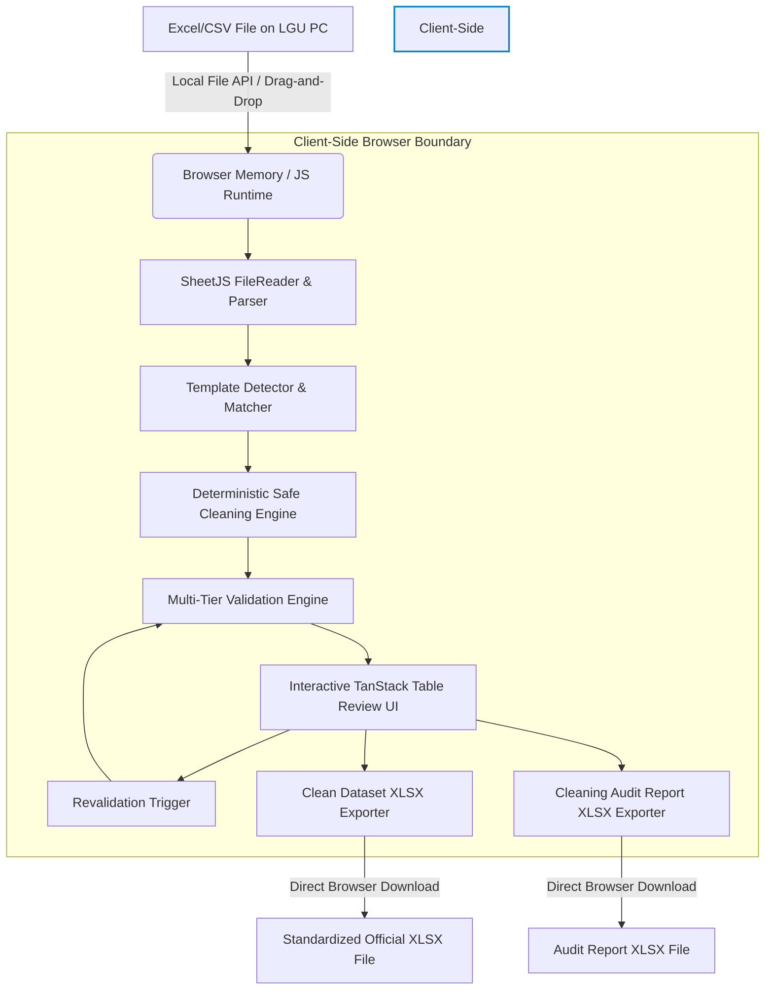

# SYSTEM ARCHITECTURE DOCUMENT
## DataClean: DBL & ODeSSEE Data Cleaning and Preparation Tool
**Document Version:** 1.0.0  
**Target Environment:** Next.js (Client-Side SPA / Static Export) on Vercel  
**Primary Constraints:** 100% Client-Side In-Browser Execution | Zero Server Storage | Zero Data Fabrication

---

## 1. Architectural Philosophy & Privacy Model

### 1.1 Zero-Backend / Local-Only Processing (Privacy by Design)
The application handles sensitive official government records (e.g., citizen demographic profiles, household CBMS identifiers, utility accounts, blotter reports, evacuation resources).
To comply with Philippine Data Privacy Act of 2012 (RA 10173) and strict LGU operational requirements:
- **No Remote Transmission:** File uploads never leave the participant's browser. No backend APIs, microservices, databases (Postgres, MySQL, Supabase, Firebase), or external cloud storage are utilized.
- **Volatile In-Memory State:** All parsed rows, clean transformations, and validation indices reside strictly in browser memory (JavaScript heap / React state / optional IndexedDB buffer).
- **Ephemeral Session:** Closing or refreshing the browser tab completely clears the dataset.
- **Banner Notice:** Every view displays the verified guarantee:
  > *"Your file is processed locally in your browser and is not uploaded or stored on our server."*



---

## 2. Technology Stack & Component Ecosystem

| Layer | Technology | Justification |
| :--- | :--- | :--- |
| **Framework** | Next.js 14+ (App Router) | High-performance, modern React architecture with static output compatibility for Vercel. |
| **Language** | TypeScript 5+ | Strict type-safety across all 15 template schemas, rules, issues, and audit records. |
| **Styling** | Vanilla CSS + Tailwind CSS | Highly customized, professional government-tier design system with dark/light harmony. |
| **UI Components** | shadcn/ui + Radix UI | Accessible, keyboard-navigable, lightweight UI primitives (modals, dropdowns, badges, tooltips). |
| **Spreadsheet Engine** | SheetJS (`xlsx`) | Fast, local parsing of binary `.xlsx`, `.xls`, and plaintext `.csv` files into typed cell matrices. |
| **Data Grid** | TanStack Table v8 | Virtualized, high-performance tabular display capable of smoothly rendering thousands of LGU rows. |
| **Icons** | Lucide React | Clean, intuitive iconography for government non-technical users. |
| **Visualizations** | Recharts | Focused, lightweight data-readiness rings, quality breakdown charts, and issue distributions. |

---

## 3. End-to-End Processing Pipeline

### Stage 1: File Ingestion & Parsing
1. Accepts `.xlsx`, `.xls`, or `.csv` via HTML5 drag-and-drop or file picker.
2. Read into an `ArrayBuffer` locally using `FileReader.readAsArrayBuffer()`.
3. SheetJS parses the workbook with options `{ type: "array", cellDates: true, cellNF: true, raw: false }`.
4. Workbook metadata is extracted: sheet list, sheet names, visible vs hidden sheets.
5. If multiple sheets exist, user or auto-selector identifies the primary data sheet (filtering out `Instructions`, `Guide`, `Notes`).

### Stage 2: Template Detection & Matching
1. **Header Extraction:** Normalizes header candidate row (checks Row 1, or Row 2 in case of merged super-headers).
2. **Similarity Scoring Algorithm:**
   - Normalizes all uploaded headers (lowercase, trimmed, punctuation stripped).
   - Evaluates Jaccard similarity and exact alias matching against each of the 15 template definitions:
     $$\text{Confidence Score} = \frac{\sum \text{Matched Column Weights}}{\text{Total Template Expected Columns}} \times 100\%$$
   - Generates Match Breakdown: Matched Columns ($\checkmark$), Missing Columns ($\Delta$), Extra/Unknown Columns ($?$).
3. **Manual Override:** User can always override the auto-detection to select System (`DBL` / `ODeSSEE`) and Target Dataset.

### Stage 3: Template Conversion (Old/Incomplete Support)
1. If an uploaded dataset matches an older version or omits mandatory/optional columns (e.g. Water template missing `Street` and `Purok`):
   - User is presented with **"Convert to Current Template"**.
   - Preserves all existing matched data intact.
   - Synthesizes the missing required columns at their exact canonical template positions.
   - Newly created columns are initialized to `null` / `""` (Zero Fabrication).
   - Missing required cells are immediately flagged as **ERROR (Missing Mandatory Field)** for user entry.

### Stage 4: Safe Cleaning Engine (Deterministic Auto-Fixes)
Executes deterministic, non-destructive transformations:
- Strips completely empty rows.
- Trims leading/trailing whitespace and non-breaking spaces.
- Normalizes internal multiple whitespace down to single spaces.
- Strips currency symbols (`₱`, `$`, `PHP`), commas (`,`), and unit signs from numeric fields.
- Preserves string representations of identifiers to retain leading zeros.
- Normalizes standard dates into canonical ISO `YYYY-MM-DD`.
- Logs every auto-fix into the `changeLog` with status `AUTO-FIX`.

### Stage 5: Validation Engine & Readiness Scoring
Evaluates every record against template-specific field definitions:
- **Type Validation:** Validates integer, float, date, boolean, coordinate bounds.
- **Required Check:** Flags empty cells in required fields as **ERROR**.
- **Categorical Check:** Flags unrecognized categories as **REVIEW** (with fuzzy suggestions if applicable).
- **Duplicate Check:** Identifies records violating candidate composite keys.
- **Transparent Readiness Score Formula:**
  $$\text{Readiness Score} = \left( 1 - \frac{\text{Total Blocking Errors} + (0.5 \times \text{Unresolved Review Issues})}{\text{Total Records} \times \text{Required Fields Count}} \right) \times 100\%$$
  *Note:* The system strictly prevents showing 100% Readiness if even a single blocking error remains.

### Stage 6: Human Review & Interactive Editing
- Virtualized TanStack spreadsheet grid with color-coded status badges.
- Filtering by row status: `All`, `Valid`, `Auto-Cleaned`, `Needs Review`, `Errors`.
- Cell-level interactive inspector:
  - Displays: Original Value, Suggested Value, Rule Violated, Explanation.
  - User Actions: `Accept Suggestion`, `Edit Manually`, `Keep Original`.
- Bulk Action: **"Apply All Safe Fixes"** (only executes deterministic auto-fixes; never auto-accepts ambiguous review items).

### Stage 7: Revalidation
- After any manual edit or bulk action, the entire dataset re-runs through Stage 5.
- Real-time updates to the Readiness percentage, issue counters, and error badges.

### Stage 8: Export Engine
1. **Clean Dataset (`.xlsx`):**
   - Built using SheetJS `XLSX.utils.book_new()`.
   - Uses official sheet name (e.g. `Data`).
   - Exports exact canonical header names in strictly mandated column order.
   - Formatted cells with proper Excel number/date formatting.
2. **Cleaning Audit Report (`.xlsx`):**
   - Comprehensive audit log for LGU capacity-building records.
   - Columns: `Row`, `Field`, `Original Value`, `Final Value`, `Issue Detected`, `Action Taken`, `Status`.

---

## 4. Proposed Directory Layout

```
src/
├── app/
│   ├── layout.tsx                     # Global layout, fonts, privacy banner
│   ├── page.tsx                       # Home page: DBL & ODeSSEE selection cards
│   ├── clean/
│   │   └── page.tsx                   # Main cleaning workspace (Upload -> Quality -> Review -> Export)
│   └── globals.css                    # Design system tokens and styling
│
├── components/
│   ├── common/
│   │   ├── Header.tsx                 # App header with branding and privacy indicator
│   │   ├── PrivacyBadge.tsx           # "Processed locally" badge & info modal
│   │   └── StatCard.tsx               # Metric cards for data quality
│   ├── upload/
│   │   ├── FileDropzone.tsx           # Drag & drop file ingestion with local parsing
│   │   ├── TemplateSelector.tsx       # System & Dataset manual selector
│   │   └── DetectionCard.tsx          # Match confidence score and column alignment breakdown
│   ├── quality/
│   │   ├── ReadinessGauge.tsx         # Transparent % readiness gauge
│   │   ├── IssueSummary.tsx           # Issue distribution (Missing, Format, Dupes, etc.)
│   │   └── TemplateConvertBanner.tsx  # "Convert to Current Template" CTA
│   ├── review/
│   │   ├── DataReviewTable.tsx        # Virtualized TanStack spreadsheet table
│   │   ├── CellIssuePopover.tsx       # Cell problem inspector and action controls
│   │   ├── TableToolbar.tsx           # Search, filter pills, bulk actions
│   │   └── ManualEditModal.tsx        # Modal for manual data correction
│   └── export/
│       └── ExportPanel.tsx            # Download Clean XLSX & Download Audit Report buttons
│
├── lib/
│   ├── types/
│   │   ├── dataset.ts                 # DatasetDefinition, FieldDefinition, SystemType
│   │   ├── rules.ts                   # ValidationRule, CleaningRule, RuleClassification
│   │   ├── record.ts                  # CleanRecord, CellState, CleaningChange, ValidationIssue
│   │   └── report.ts                  # QualityReport, ReadinessStats
│   ├── templates/
│   │   ├── index.ts                   # Registry of all 15 datasets
│   │   ├── dbl/
│   │   │   ├── business.ts
│   │   │   ├── crime.ts
│   │   │   ├── human-resource.ts
│   │   │   ├── power.ts
│   │   │   ├── residential.ts
│   │   │   ├── telecommunication.ts
│   │   │   ├── transportation.ts
│   │   │   └── water.ts               # DBL Water primary prototype definition
│   │   └── odessee/
│   │       ├── barangay-household.ts
│   │       ├── covid-cases.ts
│   │       ├── disaster-incident.ts
│   │       ├── drrm-resources.ts
│   │       ├── evacuation-sites.ts
│   │       ├── flood-susceptibility.ts
│   │       └── vulnerability-risk.ts
│   ├── parser/
│   │   ├── excelParser.ts             # SheetJS local file reader and matrix extractor
│   │   └── normalizer.ts              # Row object normalizer
│   ├── detector/
│   │   └── templateDetector.ts        # Header matcher, Jaccard similarity, confidence calculator
│   ├── cleaner/
│   │   ├── safeCleaner.ts             # Deterministic auto-fixes (trim, whitespace, leading zeros)
│   │   └── typeCasters.ts             # Safe numeric, date, and boolean normalizers
│   ├── validator/
│   │   ├── validationEngine.ts        # Core validation evaluator
│   │   ├── duplicateDetector.ts       # Composite key duplicate checker
│   │   └── readinessCalculator.ts     # Formula-based readiness calculator
│   └── exporter/
│       ├── cleanDataExporter.ts       # XLSX generator for clean data
│       └── auditReportExporter.ts     # XLSX generator for Cleaning Audit Report
```

---

## 5. Performance Strategy (Large LGU Datasets)

1. **Decoupled Computation:** Parsing, auto-cleaning, and validation are executed sequentially as pure functions outside React's render loop.
2. **Virtualized Rendering:** TanStack Table virtualizes rows to ensure smooth 60fps scrolling even with 5,000+ records.
3. **Optimized Change Immutability:** Cell modifications update indexed row maps rather than duplicating large arrays.
4. **Web Worker Readiness:** The architecture strictly isolates the `cleaner/` and `validator/` libraries as stateless pure functions, allowing trivial migration into a Web Worker background thread if datasets exceed 10,000 rows.
